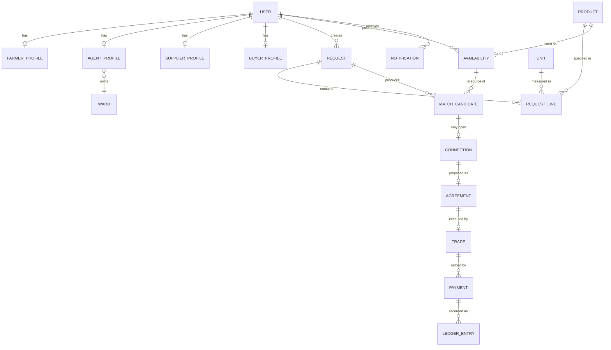
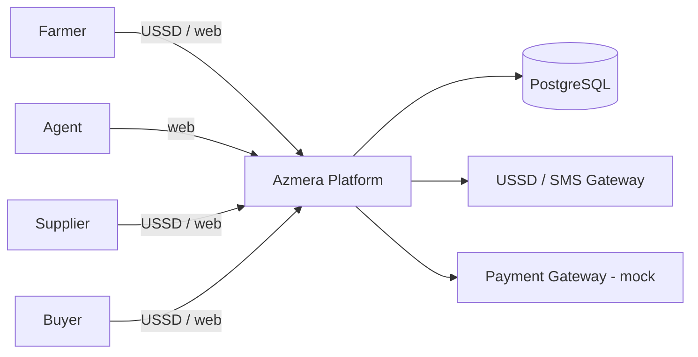
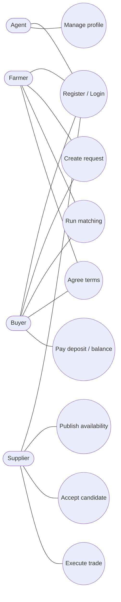
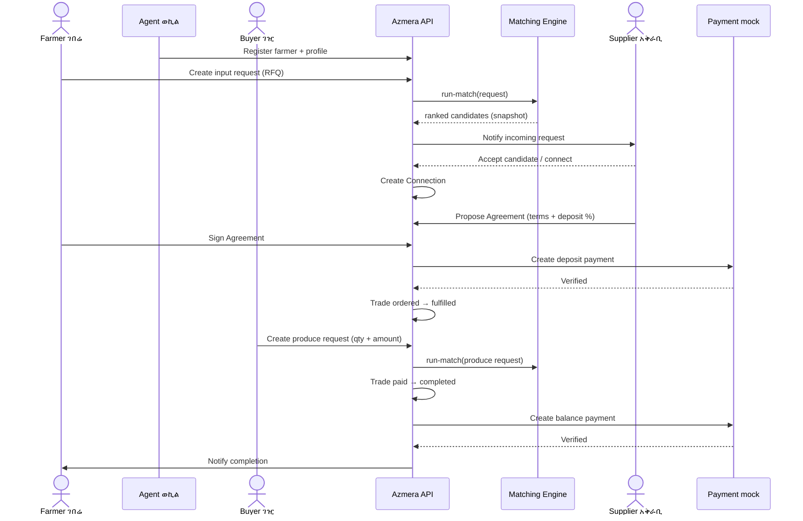
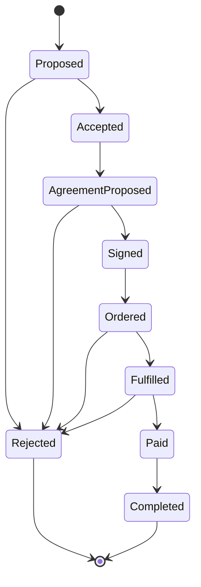

# Software Requirements Specification (SRS) - Azmera

| Field | Value |
| --- | --- |
| Document title | Software Requirements Specification - Azmera |
| Version | 1.0 |
| Status | Draft |
| Type | Internal engineering specification |
| Product | Azmera - agricultural matching platform |
| Core flow | REGISTER → REQUEST → MATCH → CONNECT → AGREE → TRADE |
| Repository | `Azmera-pay` (monorepo: `backend/`, `frontend/`, `docs/`) |

---

## 1. Introduction

### 1.1 Purpose

This document specifies the requirements for **Azmera**, a USSD-first agricultural matching
platform that connects farmers, agents, input suppliers and buyers in Ethiopia. It is written
for the engineering team as a single, testable source of truth for what the system shall do.

### 1.2 Scope

Azmera lets a farmer request agricultural inputs (seeds, fertilizer, pesticides) and lets a
buyer request produce (e.g. tomatoes) with a quantity and a stated amount. A shared matching
engine ranks eligible counterparties; the parties connect, formalize an agreement, and complete
a trade with a deposit and balance payment.

Channels:

- **USSD** - the primary channel, usable on any feature phone without internet.
- **Web dashboards** - one workspace per role (React), for richer data entry and tracking.
- **SMS** - notifications.

### 1.3 Intended audience

Backend and frontend engineers, QA, and product owners. Readers are assumed to understand web
APIs, relational data modeling, and the agricultural domain at a high level.

### 1.4 Definitions and abbreviations

| Term | Meaning | Amharic |
| --- | --- | --- |
| USSD | Unstructured Supplementary Service Data; session-based phone menu | - |
| Request | A demand record of kind `input` (farmer) or `produce` (buyer) | ጥያቄ |
| RequestLine | One product line inside a Request (product, quantity, price, max distance) | - |
| Listing / Availability | A supplier's published stock and price with a validity period | - |
| MatchCandidate | An immutable snapshot of a scored request/listing pairing | - |
| Connection | A proposed link opened between matched parties | ግንኙነት |
| Agreement | Formal terms + deposit % that both parties sign | ስምምነት |
| Trade | An execution of a signed agreement (ordered → fulfilled → paid → completed) | ንግድ |
| Deposit | Percentage of the deal amount paid at agreement signing | ቅድሚያ ክፍያ |
| Balance | Remaining amount paid when the trade completes | ቀሪ ክፍያ |
| Agent | Field representative who registers and assists farmers, owns a ward | ወኪል |
| Farmer | Producer who requests inputs and supplies produce | ገበሬ |
| Supplier | Provider of inputs and/or produce stock | አቅራቢ |
| Buyer | Party requesting produce with quantity and amount | ገዢ |
| Region / Woreda | Administrative area / district used for location matching | ክልል / ወረዳ |
| Quintal | Unit of mass (100 kg) common in local produce trade | ኩንታል |
| ETB | Ethiopian Birr | ብር |
| JWT | JSON Web Token used for API authentication | - |

### 1.5 References

- `docs/architecture.md` - system architecture and key decisions
- `docs/domain.md` - domain rules, matching, deal state machine, payments
- `docs/api.md` - planned REST API surface under `/api/v1/`
- `backend/core/matching/engine.py`, `backend/core/matching/constants.py` - implemented matcher

### 1.6 Document conventions

- `shall` denotes a binding requirement; `should` a recommendation; `may` an option.
- Requirements are identified as `FR-<MODULE>-<n>` (functional) and `NFR-<CAT>-<n>` (non-functional).
- Priority uses MoSCoW: **Must**, **Should**, **Could**.

---

## 2. Overall description

### 2.1 Product perspective

Azmera is a single-repository monolith: a Django REST Framework API with PostgreSQL, consumed
by a React + TypeScript web app and by a USSD/SMS gateway. The matching engine is a pure,
Django-independent function so it can run synchronously now and be moved to a background worker
later without changing the application layer.

### 2.2 Product functions

1. Register users and role profiles (farmer, agent, supplier, buyer, admin).
2. Publish supplier availability (stock, price, validity).
3. Create input and produce requests with one or more lines.
4. Run location-aware matching and produce ranked, reproducible candidates.
5. Connect matched parties and formalize agreements.
6. Execute trades through a state machine.
7. Settle payments (deposit at signing, balance at completion) with double-entry records.
8. Notify parties via in-app and SMS.
9. Provide per-role dashboards and admin KPIs.

### 2.3 User classes and characteristics

| Role | Description | Key needs |
| --- | --- | --- |
| Farmer | Rural producer, often low-literacy, feature phone | Register via agent, request inputs, review matches, track deals |
| Agent | Field representative; owns a ward | Register/verify farmers, manage a ward, assist USSD onboarding |
| Supplier | Input and/or produce provider | Publish stock/price, receive requests, connect when agreed |
| Buyer | Trader / business | Create produce request with quantity + amount, review matches, sign, pay |
| Admin | Operator | KPIs, user administration, moderation |

### 2.4 Operating environment

- USSD sessions on any GSM feature phone; SMS notifications.
- Web app on modern browsers for users with data access.
- Backend: Django + PostgreSQL; Redis optional for future async matching and rate limiting.
- Low-bandwidth, intermittent connectivity; agent-assisted onboarding is expected.

### 2.5 Design and implementation constraints

- USSD menus are limited in length and interaction steps; text must be short and localized.
- Prices and quantities are decimal money/quantities in **ETB** and local units (e.g. quintal).
- Location matching is constrained to the 14 canonical Ethiopian regions plus woreda text.
- Payments use a **mock gateway** in v1 (`MockGateway`); no live provider dependency.

### 2.6 Assumptions and dependencies

- A USSD/SMS gateway provider and telecom integration will be available.
- Farmers/suppliers provide region and woreda; agents help correct invalid values.
- Exchange/unit data (products, units) is seeded via `scripts/`.

### 2.7 Out of scope (v1)

- Live payment provider integration and payouts.
- Real-time chat; connections are mediated listings/messages only.
- Multi-language USSD beyond English and Amharic.
- Native mobile applications.

---

## 3. Functional requirements

### 3.1 Accounts and authentication (`AUTH`)

| ID | Requirement | Priority |
| --- | --- | --- |
| FR-AUTH-1 | The system shall register a user with phone number, email and role. | Must |
| FR-AUTH-2 | The system shall authenticate a user and return access and refresh JWTs. | Must |
| FR-AUTH-3 | The system shall refresh an expired access token using a valid refresh token. | Must |
| FR-AUTH-4 | The system shall expose the current authenticated user via `GET /auth/me`. | Must |
| FR-AUTH-5 | The system shall enforce role-based authorization on every role-scoped endpoint. | Must |

### 3.2 Profiles and ward (`PROF`)

| ID | Requirement | Priority |
| --- | --- | --- |
| FR-PROF-1 | The system shall let a user read and update their own role profile. | Must |
| FR-PROF-2 | The system shall let an agent assign and manage a ward. | Should |
| FR-PROF-3 | The system shall expose a public role profile by user id. | Should |

### 3.3 Catalog and availability (`CAT`)

| ID | Requirement | Priority |
| --- | --- | --- |
| FR-CAT-1 | The system shall list products filtered by category, price range and quantity. | Must |
| FR-CAT-2 | The system shall let a supplier create, update and deactivate availability (stock, price, validity). | Must |
| FR-CAT-3 | The system shall treat only `active` listings within validity as matchable. | Must |

### 3.4 Requests (`REQ`)

| ID | Requirement | Priority |
| --- | --- | --- |
| FR-REQ-1 | The system shall let a farmer create an `input` request. | Must |
| FR-REQ-2 | The system shall let a buyer create a `produce` request with quantity and a stated amount. | Must |
| FR-REQ-3 | The system shall store each request with one or more lines (product, quantity + unit, price/budget, max distance). | Must |
| FR-REQ-4 | The system shall let the owner read, update and cancel their request. | Must |
| FR-REQ-5 | The system shall list requests by role (mine, inbox). | Should |

### 3.5 Matching (`MATCH`)

The implemented matcher (`core/matching/engine.py`) first filters by eligibility, then computes
an explanatory score, then ranks candidates.

| ID | Requirement | Priority |
| --- | --- | --- |
| FR-MATCH-1 | The system shall run matching for a request synchronously on demand. | Must |
| FR-MATCH-2 | The system shall reject listings that fail: not active, product mismatch, unit mismatch, insufficient quantity, over budget, or invalid region. | Must |
| FR-MATCH-3 | The system shall compute a score of location points (same woreda 60, same region 30, other region 10) plus price points (max 25) plus quantity points (max 15). | Must |
| FR-MATCH-4 | The system shall rank candidates by location tier, then lowest unit price, then highest available quantity, then listing id. | Must |
| FR-MATCH-5 | The system shall persist each result as an immutable `MatchCandidate` snapshot (score + reasons) for reproducibility. | Must |
| FR-MATCH-6 | The system shall return ranked candidates with a score breakdown, and let the owner accept or reject a candidate. | Must |

### 3.6 Deals (`DEAL`)

| ID | Requirement | Priority |
| --- | --- | --- |
| FR-DEAL-1 | The system shall open a `Connection` from an accepted candidate. | Must |
| FR-DEAL-2 | The system shall record an `Agreement` (terms + deposit %) proposed on a connection. | Must |
| FR-DEAL-3 | The system shall let the counterparty accept or reject a proposed connection or agreement. | Must |
| FR-DEAL-4 | The system shall start a `Trade` from a signed agreement. | Must |
| FR-DEAL-5 | The system shall enforce the trade state machine: `ordered → fulfilled → paid → completed`, with rejection allowed at each gate. | Must |
| FR-DEAL-6 | The system shall list a user's deals (connections, agreements, trades). | Should |

### 3.7 Notifications (`NOTIF`)

| ID | Requirement | Priority |
| --- | --- | --- |
| FR-NOTIF-1 | The system shall create a Notification on events: match found, candidate accepted, supplier connected, agreement signed, trade updated. | Must |
| FR-NOTIF-2 | The system shall dispatch notifications in-app and via SMS. | Should |
| FR-NOTIF-3 | The system shall let a user list and mark notifications as read. | Should |

### 3.8 Payments (`PAY`)

| ID | Requirement | Priority |
| --- | --- | --- |
| FR-PAY-1 | The system shall create a `deposit` payment (agreed %) when an agreement is signed. | Must |
| FR-PAY-2 | The system shall create a `balance` payment for the remainder when the trade completes. | Must |
| FR-PAY-3 | The system shall verify payments through a gateway adapter; `MockGateway` returns success in dev. | Must |
| FR-PAY-4 | The system shall record double-entry `LedgerEntry` rows for every payment. | Should |
| FR-PAY-5 | The system shall expose a user's payment history. | Could |

### 3.9 Dashboards and administration (`DASH`)

| ID | Requirement | Priority |
| --- | --- | --- |
| FR-DASH-1 | The system shall provide a workspace per role: buyer, agent, supplier, farmer, admin. | Must |
| FR-DASH-2 | The system shall expose KPIs (users, requests, trade volume). | Should |
| FR-DASH-3 | The system shall list users with role filters for admin. | Should |
| FR-DASH-4 | The system shall let admin moderate listings and users. | Could |

### 3.10 USSD channel (`USSD`)

| ID | Requirement | Priority |
| --- | --- | --- |
| FR-USSD-1 | The system shall handle a USSD session and render short, numbered menus. | Must |
| FR-USSD-2 | The system shall let a farmer submit an input request through USSD. | Must |
| FR-USSD-3 | The system shall let a buyer submit a produce request through USSD. | Should |
| FR-USSD-4 | The system shall let a user view and accept matched candidates through USSD. | Should |
| FR-USSD-5 | The system shall support English and Amharic menus. | Could |

---

## 4. Non-functional requirements

### 4.1 Performance (`NFR-PERF`)

| ID | Requirement | Priority |
| --- | --- | --- |
| NFR-PERF-1 | Synchronous matching for a request shall complete within 2 seconds for up to 1,000 active listings. | Must |
| NFR-PERF-2 | The REST API shall return 95th-percentile responses within 500 ms for standard reads. | Should |
| NFR-PERF-3 | The web landing page shall be fully usable within 3 seconds on a 3G connection. | Should |

### 4.2 Availability and offline (`NFR-AVAIL`)

| ID | Requirement | Priority |
| --- | --- | --- |
| NFR-AVAIL-1 | The USSD/SMS channel shall remain usable when the web channel is unavailable. | Must |
| NFR-AVAIL-2 | The system shall tolerate intermittent connectivity and retry failed SMS delivery. | Should |

### 4.3 Security (`NFR-SEC`)

| ID | Requirement | Priority |
| --- | --- | --- |
| NFR-SEC-1 | All API traffic shall use HTTPS in non-development environments. | Must |
| NFR-SEC-2 | The system shall validate inputs and protect against common web attacks. | Must |
| NFR-SEC-3 | The system shall authorize every request by role and resource ownership. | Must |
| NFR-SEC-4 | The system shall store passwords using a strong one-way hash. | Must |

### 4.4 Privacy (`NFR-PRIV`)

| ID | Requirement | Priority |
| --- | --- | --- |
| NFR-PRIV-1 | The system shall expose personal contact details only to parties in a confirmed connection. | Should |
| NFR-PRIV-2 | The system shall log access to personal data for audit. | Could |

### 4.5 Localization (`NFR-LOC`)

| ID | Requirement | Priority |
| --- | --- | --- |
| NFR-LOC-1 | The system shall display money in ETB and support local units (e.g. quintal). | Must |
| NFR-LOC-2 | The system shall provide English and Amharic user-facing text for USSD. | Should |
| NFR-LOC-3 | The system shall use canonical region names and tolerate common aliases. | Must |

### 4.6 Auditability (`NFR-AUD`)

| ID | Requirement | Priority |
| --- | --- | --- |
| NFR-AUD-1 | The system shall keep immutable `MatchCandidate` snapshots. | Must |
| NFR-AUD-2 | The system shall keep double-entry ledger records for payments. | Should |

### 4.7 Scalability (`NFR-SCALE`)

| ID | Requirement | Priority |
| --- | --- | --- |
| NFR-SCALE-1 | The system shall support matching across all regions by woreda without schema changes. | Should |
| NFR-SCALE-2 | The system shall allow the matcher to move to a background worker without API changes. | Could |

### 4.8 Accessibility and maintainability (`NFR-ACC`, `NFR-MAINT`)

| ID | Requirement | Priority |
| --- | --- | --- |
| NFR-ACC-1 | The web app shall meet WCAG 2.1 AA for the public pages. | Should |
| NFR-MAINT-1 | The matching engine shall remain free of Django imports and covered by unit tests. | Must |
| NFR-MAINT-2 | The codebase shall pass lint and type-check in CI before merge. | Must |

---

## 5. External interface requirements

### 5.1 User interfaces

- **Public web** (`/`): landing page with sections for buyers, suppliers and agents; anchor navigation.
- **Role dashboards** (planned): a workspace per role with forms, lists and status tracking.
- **USSD**: numbered menus within session limits (see 5.5).
- **404**: a not-found page for unknown routes.

### 5.2 Hardware interfaces

- GSM feature phones (USSD/SMS); no special hardware required.
- Server infrastructure hosting the API and database.

### 5.3 Software interfaces

| Interface | Purpose |
| --- | --- |
| PostgreSQL | Primary data store |
| Redis (optional) | Future async matching / rate limiting |
| USSD/SMS gateway | Session handling and message delivery |
| Payment gateway adapter (`MockGateway`) | Payment verification (mocked in v1) |

### 5.4 Communication interfaces

- REST over HTTPS, JSON bodies, versioned under `/api/v1/`.
- Authentication via `Authorization: Bearer <JWT>`.
- The React dev server proxies `/api` to the backend on `localhost:8000`.

### 5.5 Sample USSD menu (bilingual)

English:

```
Azmera
1. Register
2. Request input
3. Request produce
4. My matches
5. My deals
```

Amharic:

```
አዝመራ
1. መመዝገብ
2. ግብዓት ጠይቅ
3. ምርት ጠይቅ
4. የእኔ ግጥሚያዎች
5. የእኔ ንግዶች
```

---

## 6. Data requirements

### 6.1 Logical data model



### 6.2 Data dictionary (highlights)

| Entity | Key fields |
| --- | --- |
| User | id, phone, email, role, password hash, is_active |
| FarmerProfile | user, region, woreda, crops, capacity |
| AgentProfile | user, ward, verified_farmers |
| SupplierProfile | user, products, region, woreda |
| BuyerProfile | user, business_name, region |
| Product / Unit | id, name, category / id, name, base_unit |
| Availability | supplier, product, unit, available_quantity, unit_price, valid_from, valid_to, status |
| Request | owner, kind (`input`/`produce`), status, region, woreda, amount (produce) |
| RequestLine | request, product, unit, quantity, max_unit_price, max_distance |
| MatchCandidate | request, listing, location_match, score, reasons (immutable) |
| Connection / Agreement / Trade | participants, terms, deposit %, state |
| Payment | trade, kind (`deposit`/`balance`), amount, status |
| LedgerEntry | payment, debit_account, credit_account, amount |
| Notification | user, event, channel, read_at |

### 6.3 Data retention and audit

Immutable match snapshots and double-entry ledger rows are retained for traceability. Personal
contact data is only shared within confirmed connections.

---

## 7. Analysis models

### 7.1 System context



### 7.2 Use case overview



### 7.3 Core flow sequence



### 7.4 Deal state machine



---

## 8. Traceability matrix

| Requirement group | Use case(s) | Module | Key endpoints |
| --- | --- | --- | --- |
| FR-AUTH-1..5 | Register / Login | accounts | `/auth/register`, `/auth/login`, `/auth/token/refresh`, `/auth/me` |
| FR-PROF-1..3 | Manage profile | profiles | `/me/profile`, `/users/{id}/profile`, `/agents/ward` |
| FR-CAT-1..3 | Publish availability | catalog | `/products`, `/availability` |
| FR-REQ-1..5 | Create request | requests | `/requests` |
| FR-MATCH-1..6 | Run matching / Accept candidate | matching | `/requests/{id}/run-match`, `/requests/{id}/candidates`, `/candidates/{id}/accept` |
| FR-DEAL-1..6 | Agree terms / Execute trade | deals | `/candidates/{id}/connect`, `/connections/{id}/agreements`, `/agreements/{id}/trades`, `/deals` |
| FR-NOTIF-1..3 | (cross-cutting) | notifications | `/notifications`, `/notifications/read` |
| FR-PAY-1..5 | Pay deposit / balance | payments | `/payments`, `/payments/{id}/verify` |
| FR-DASH-1..4 | (role workspaces) | dashboard | `/dashboard/*` |
| FR-USSD-1..5 | Register / Create request | channels | USSD gateway callback |

---

## 9. Appendix

### 9.1 Open questions

- Which USSD/SMS provider and shortcode will be used?
- Confirm unit conventions (quintal vs kg) per product.
- Define deposit percentage bounds and refund rules.

### 9.2 Change history

| Version | Date | Author | Change |
| --- | --- | --- | --- |
| 1.0 | (draft) | Engineering | Initial internal SRS for the full platform |